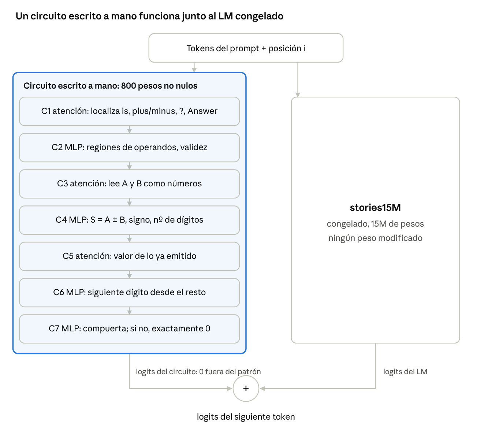

<div align="center">

# Handwritten Weights

**Escribir capacidades nuevas a mano en un modelo de lenguaje preentrenado: sin gradientes y sin datos de entrenamiento.**

[-b31b1b.svg)](paper/preprint_es.pdf)
[](paper/preprint_en.pdf)
[](LICENSE)


[English](README.md) · [Español](README.es.md)

</div>

---

Un modelo de lenguaje grande, razonando sobre lo que debe calcular cada parte de una red, escribe a mano pesos que dan a **stories15M** (un modelo Llama 2 de 15M de parámetros, entrenado solo con cuentos infantiles) capacidades que nunca tuvo:

- **Injerto:** un circuito de 7 capas escrito a mano funciona junto al modelo congelado y lleva el **benchmark de aritmética de GPT-3 del 0% al 100%**, sin cambiar **en absoluto** ninguna otra salida.
- **Cirugía dentro de los pesos:** modificando solo pesos que el modelo ya tiene, aprende **capitales de países que nunca había visto** (del 0% al 91% en paráfrasis nuevas) y a **sumar dos dígitos** (del 12% al 52% de respuestas exactas).

Ningún peso de este repositorio procede de descenso de gradiente, de un optimizador, de una búsqueda sobre pesos ni de un ajuste a etiquetas.

<p align="center"></p>

## Resultados

| Experimento | Qué cambia | stories15M | Editado |
| --- | --- | --- | --- |
| Aritmética de GPT-3, 8 subconjuntos de suma y resta (16.000 problemas) | 800 pesos nuevos junto al modelo congelado | 0% | **100%** |
| Comprobación exhaustiva, todos los *a, b* ∈ 0–99, suma y resta (20.000) | ídem | — | **100%** |
| Pérdida en texto de validación de TinyStories | ídem | perplejidad 3,003201 | **3,003201** (idéntica) |
| 7 capitales de países, paráfrasis nuevas | solo pesos existentes | 0% | **91,4%** (variante estricta: 68,6%, sin capitales inventadas) |
| Suma de dos dígitos, respuesta exacta, sumas ≤ 9 | solo pesos existentes | 11,9% | **52,4%** |

```text
Q: What is 7 minus 66?          stories15M:  "Mommy, what is that?"
                                + circuito:  " -59"

The capital of France is         stories15M:  " a very special person"
                                 cirugía:     " Paris"
```

## Estructura

```text
handwritten-weights/
├── src/                     # todos los experimentos con stories15M (se ejecutan desde esta carpeta)
│   ├── llama.py             #   cargador mínimo de llama2.c y pasada hacia delante (float64)
│   ├── circuit.py           #   Sección 3: el circuito aritmético de 7 capas escrito a mano
│   ├── eval.py              #   benchmark de aritmética de GPT-3, base frente a injertado
│   ├── exhaustive_graft.py  #   los 20.000 problemas de suma y resta con operandos 0-99
│   ├── preserve.py          #   efectos secundarios: logits del circuito en cuentos, generaciones
│   ├── facts6.py facts7.py  #   Sección 4: etiquetas, detectores, canales de atención, neuronas "Y"
│   ├── arith2.py arith4.py  #   Sección 5: aritmética con código angular dentro de los pesos
│   └── ...                  #   herramientas comunes (surgery.py, stats.py, const_dir.py, corpus.py)
├── adder_from_scratch/      # calentamiento: un sumador de 2 capas escrito desde cero (exacto hasta 2.000 dígitos)
├── results/                 # resultados en JSON citados en el artículo
├── paper/                   # preprint (EN, ES) en PDF y LaTeX
├── scripts/download_model.py
└── Makefile                 # un objetivo por tabla
```

## Inicio rápido

Requisitos: Python 3.10+, PyTorch (basta con CPU), ~1 GB de RAM por ejecución.

```bash
git clone https://github.com/RobertoVetere/handwritten-weights.git
cd handwritten-weights
pip install -r requirements.txt
make setup          # descarga stories15M y el tokenizador (con comprobación SHA-256), genera corpus y estadísticas
make graft N=200    # Tabla 1 con 200 problemas por subconjunto (unos minutos)
```

## Reproducir el artículo

| Comando | Artículo | Qué muestra | Tiempo (2 núcleos) |
| --- | --- | --- | --- |
| `make graft` | Tabla 1 | acierto por subconjunto de GPT-3, base frente a injertado | ~35 min (`N=2000`) |
| `make graft-exhaustive` | Tabla 1, última fila | 20.000 / 20.000 | ~15 min |
| `make graft-side-effects` | Sección 3 | máx. \|logit del circuito\| en cuentos = 0; generaciones idénticas | ~3 min |
| `make facts` | Tabla 2 | variantes a, b, c: diseño, paráfrasis, falsos positivos, pérdida | ~25 min |
| `make arith` | Tabla 3 | respuestas exactas y pérdida en cuentos, base frente a editado | ~10 min |
| `make adder` | calentamiento | comprobación exhaustiva del sumador y el restador escritos desde cero | ~2 min |

Todas las ejecuciones son deterministas (semillas fijas, float64). Las salidas de referencia están en [`results/`](results).

## Cómo funciona

**Injerto (sección 3).** El circuito solo ve la identidad de los tokens y su posición. Una capa de atención localiza las marcas de la pregunta; otra lee cada operando como un número exacto ponderando los dígitos por potencias de diez frente a un token sumidero fijo; los MLP calculan el resultado, su signo y su longitud, y emiten los dígitos uno a uno. Su última capa da exactamente 0 salvo que el prompt encaje, y por eso el resto del modelo queda intacto.

**Hacer visibles los tokens raros (sección 4).** stories15M no distingue "Spain" de "Japan": seis de los siete países tienen embeddings con coseno 0,96–0,999 entre sí, porque nunca aparecieron en el entrenamiento. Unas etiquetas pequeñas en direcciones tranquilas los hacen distinguibles; unas neuronas las amplifican; un par RoPE liberado da a dos cabezas un canal de atención dedicado; y unas neuronas "Y" escriben la capital.

**Aritmética con código angular (sección 5).** RMSNorm distorsiona las magnitudes, así que cada dígito *d* se escribe como *K*(cos *d*φ, sin *d*φ, 1): norma constante, claves de atención iguales, y la media de dos dígitos apunta al ángulo (*a+b*)φ/2. Una cabeza reconvertida promedia los dígitos y unas pruebas de semiplano independientes de la escala leen la suma.

La tabla de herramientas del artículo recoge las técnicas que lo hicieron posible bajo RMSNorm: direcciones tranquilas, códigos de norma constante, pruebas homogéneas, marcas de una sola capa, canales de atención dedicados, sumideros de atención, sustitutos del sesgo y escalones recortados.

## Limitaciones

Son pruebas de concepto sobre un único modelo de 15M de parámetros. El injerto añade pesos junto al modelo y lee una única plantilla de prompt. Las ediciones dentro de los pesos cuestan entre un 4% y un 8% de pérdida en cuentos; la edición aritmética solo produce la primera cifra de las sumas de dos cifras y puede colar dígitos en cuentos que contienen números. Todos los pesos los escribió un único LLM en una sola sesión de trabajo. Ver la sección 8 del artículo.

## Cita

```bibtex
@misc{handwrittenweights2026,
  title  = {Writing New Capabilities into a Pretrained Language Model by Hand},
  author = {Vetere, Roberto},
  year   = {2026},
  note   = {Preprint},
  url    = {https://github.com/RobertoVetere/handwritten-weights}
}
```

## Agradecimientos

Todos los pesos los diseñó y escribió **Claude (Anthropic)**, trabajando en un entorno Python bajo la dirección del autor. El modelo receptor es `stories15M` de [llama2.c](https://github.com/karpathy/llama2.c) de Karpathy, entrenado con [TinyStories](https://hf.co/datasets/roneneldan/TinyStories); las filas del benchmark proceden de [EleutherAI/arithmetic](https://hf.co/datasets/EleutherAI/arithmetic). Este trabajo continúa [Sparks of Weight-Space Programming](https://rikiyat.github.io/blog/weight-space-programming/) (Takehi, Teoh, Zhang, Khattab, 2026).

## Licencia

[MIT](LICENSE). Los pesos de stories15M se descargan de sus fuentes originales y no se redistribuyen aquí.
