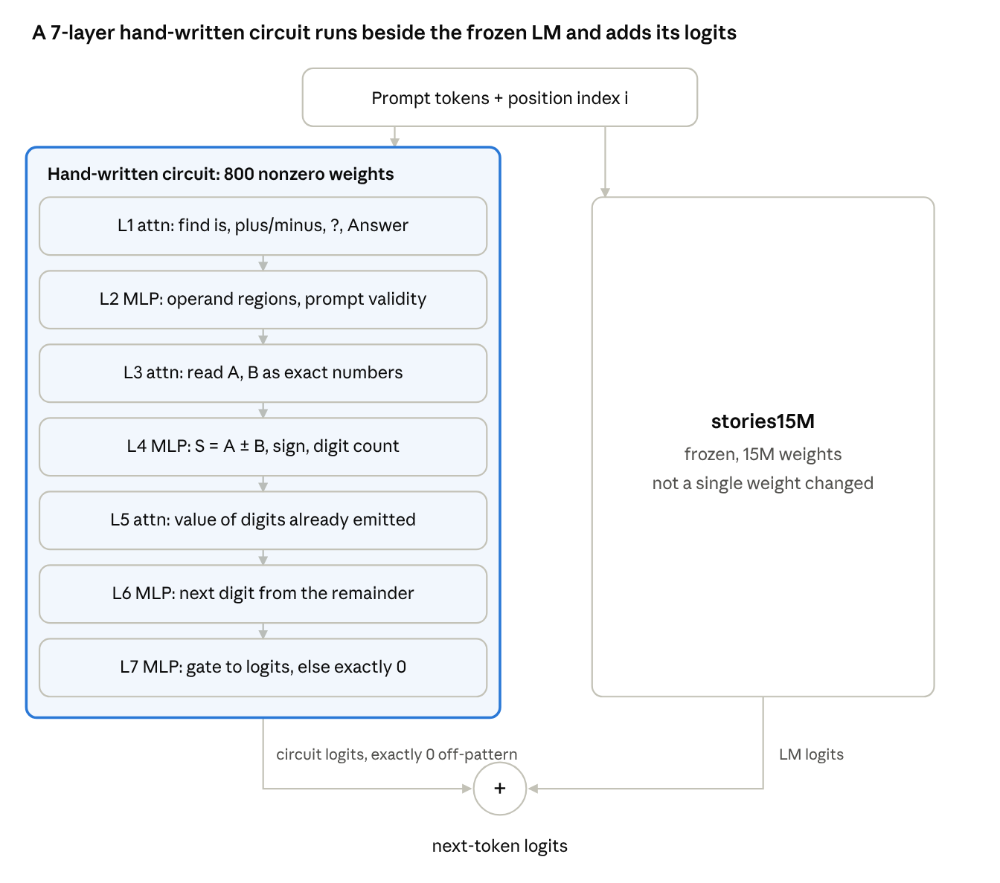

<div align="center">

# Handwritten Weights

**Writing new capabilities into a pretrained language model by hand — no gradients, no training data.**

[](paper/preprint_en.pdf)
[-b31b1b.svg)](paper/preprint_es.pdf)
[](LICENSE)


[English](README.md) · [Español](README.es.md)

</div>

---

A large language model, reasoning about what each part of a network should compute, writes weights by hand that give **stories15M** — a 15M-parameter Llama-2 model trained only on children's stories — capabilities it never had:

- **Grafting:** a 7-layer circuit written by hand runs beside the frozen model and takes the **GPT-3 arithmetic benchmark from 0% to 100%**, while every other output stays **exactly** unchanged.
- **In-weight surgery:** editing only weights the model already has, it learns **country capitals it had never seen** (0% → 91% on unseen paraphrases) and **single-digit addition** (12% → 52% exact answers).

No weight in this repository comes from gradient descent, an optimizer, a search over weights, or a fit to labels.

<p align="center"></p>

## Results at a glance

| Experiment | What changes | stories15M | Edited |
| --- | --- | --- | --- |
| GPT-3 arithmetic, 8 add/sub subsets (16,000 problems) | 800 new weights beside the frozen model | 0% | **100%** |
| Exhaustive check, all *a, b* ∈ 0–99, add and sub (20,000) | same | — | **100%** |
| Loss on TinyStories validation text | same | 3.003201 ppl | **3.003201 ppl** (identical) |
| 7 country capitals, unseen paraphrases | existing weights only | 0% | **91.4%** (strictest variant: 68.6%, no invented capitals) |
| Single-digit addition, exact answer, sums ≤ 9 | existing weights only | 11.9% | **52.4%** |

```text
Q: What is 7 minus 66?          stories15M:  "Mommy, what is that?"
                                + circuit:   " -59"

The capital of France is         stories15M:  " a very special person"
                                 surgery:     " Paris"
```

## Repository layout

```text
handwritten-weights/
├── src/                     # all experiments on stories15M (run from this folder)
│   ├── llama.py             #   minimal llama2.c loader + forward pass (float64)
│   ├── circuit.py           #   Section 3: the hand-written 7-layer arithmetic circuit
│   ├── eval.py              #   GPT-3 arithmetic benchmark, base vs grafted
│   ├── exhaustive_graft.py  #   all 20,000 add/sub problems with operands 0-99
│   ├── preserve.py          #   side effects: circuit logits on stories, generations
│   ├── facts6.py facts7.py  #   Section 4: tags, detectors, attention channels, AND neurons
│   ├── arith2.py arith4.py  #   Section 5: angle-coded arithmetic inside the weights
│   └── ...                  #   shared tools (surgery.py, stats.py, const_dir.py, corpus.py)
├── adder_from_scratch/      # warm-up: a 2-layer adder written from scratch (exact to 2,000 digits)
├── results/                 # JSON results reported in the paper
├── paper/                   # preprint (EN, ES) as PDF and LaTeX
├── scripts/download_model.py
└── Makefile                 # one target per table
```

## Quickstart

Requirements: Python 3.10+, PyTorch (CPU is enough), ~1 GB of RAM per run.

```bash
git clone https://github.com/RobertoVetere/handwritten-weights.git
cd handwritten-weights
pip install -r requirements.txt
make setup          # download stories15M + tokenizer (SHA-256 checked), build corpus and statistics
make graft N=200    # Table 1 on 200 problems per subset (a few minutes)
```

## Reproducing the paper

| Command | Paper | What it prints | Time (2 CPU cores) |
| --- | --- | --- | --- |
| `make graft` | Table 1 | accuracy per GPT-3 subset, base vs grafted | ~35 min (`N=2000`) |
| `make graft-exhaustive` | Table 1, last row | 20,000 / 20,000 | ~15 min |
| `make graft-side-effects` | Section 3 | max \|circuit logit\| on stories = 0; identical generations | ~3 min |
| `make facts` | Table 2 | variants a, b, c: design, paraphrases, false positives, loss | ~25 min |
| `make arith` | Table 3 | exact answers and story loss, base vs edited | ~10 min |
| `make adder` | warm-up | exhaustive check of the from-scratch adder and subtractor | ~2 min |

All runs are deterministic (fixed seeds, float64). Reference outputs are in [`results/`](results).

## How it works

**Grafting (Section 3).** The circuit sees only token identities and positions. Attention finds the question's markers; a second attention layer reads each operand as an exact number by weighting digits by powers of ten against a fixed sink token; MLPs compute the result, its sign and length, and emit digits one by one. Its final layer outputs exactly 0 unless the prompt matches, which is why the model is otherwise untouched.

**Making rare tokens visible (Section 4).** stories15M cannot tell "Spain" from "Japan": six of seven country tokens have pairwise embedding cosine 0.96–0.999 because they never appeared in training. Small tags in quiet directions make them distinguishable; neurons amplify the tags; a freed RoPE pair gives two heads a dedicated attention channel; AND neurons write the capital.

**Angle-coded arithmetic (Section 5).** RMSNorm distorts magnitudes, so each digit *d* is written as *K*(cos *d*φ, sin *d*φ, 1): constant norm, equal attention keys, and the average of two digits points at angle (*a+b*)φ/2. A repurposed head averages the digits; scale-free half-plane tests read the sum.

The paper's toolkit table collects the techniques that made this work under RMSNorm: quiet directions, constant-norm codes, homogeneous tests, single-layer flags, dedicated attention channels, attention sinks, bias substitutes and clipped steps.

## Limitations

These are proofs of concept on one 15M-parameter model. The graft adds weights beside the model and reads a single prompt template. The in-weight edits cost 4–8% story loss; the arithmetic edit only produces the first digit of two-digit sums and can leak digits into stories that contain numbers. All weights were written by one LLM in one working session. See Section 8 of the paper.

## Citation

```bibtex
@misc{handwrittenweights2026,
  title  = {Writing New Capabilities into a Pretrained Language Model by Hand},
  author = {Vetere, Roberto},
  year   = {2026},
  note   = {Preprint},
  url    = {https://github.com/RobertoVetere/handwritten-weights}
}
```

## Acknowledgments

All weights were designed and written by **Claude (Anthropic)**, working in a Python sandbox under the direction of the author. The recipient model is Karpathy's [llama2.c](https://github.com/karpathy/llama2.c) `stories15M`, trained on [TinyStories](https://hf.co/datasets/roneneldan/TinyStories); benchmark rows come from [EleutherAI/arithmetic](https://hf.co/datasets/EleutherAI/arithmetic). This work follows up on [Sparks of Weight-Space Programming](https://rikiyat.github.io/blog/weight-space-programming/) (Takehi, Teoh, Zhang, Khattab, 2026).

## License

[MIT](LICENSE). The stories15M weights are downloaded from their original sources and are not redistributed here.
